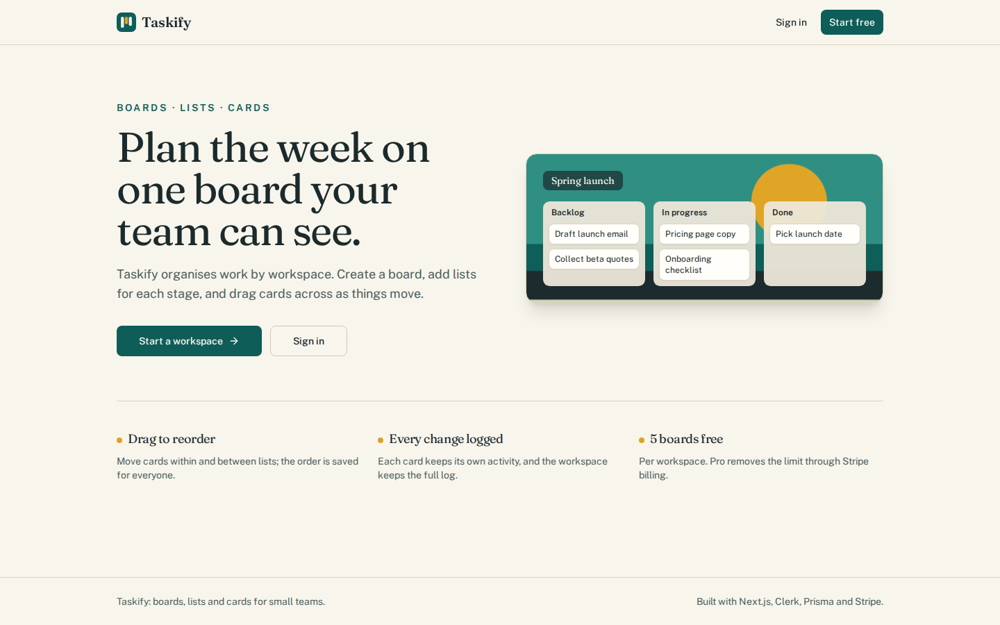
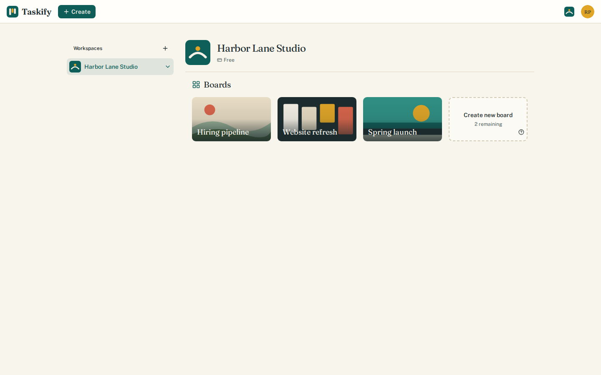
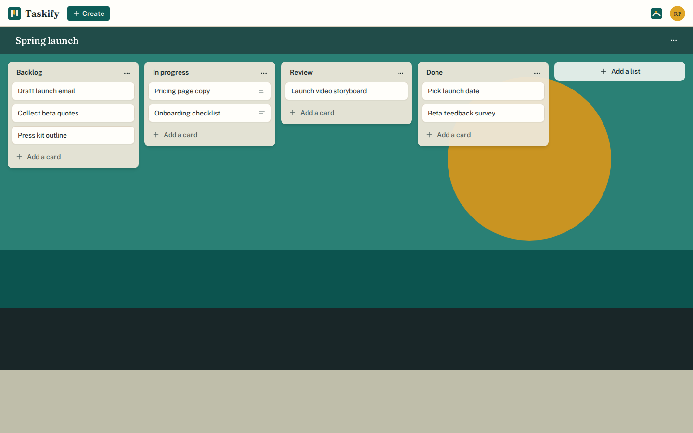
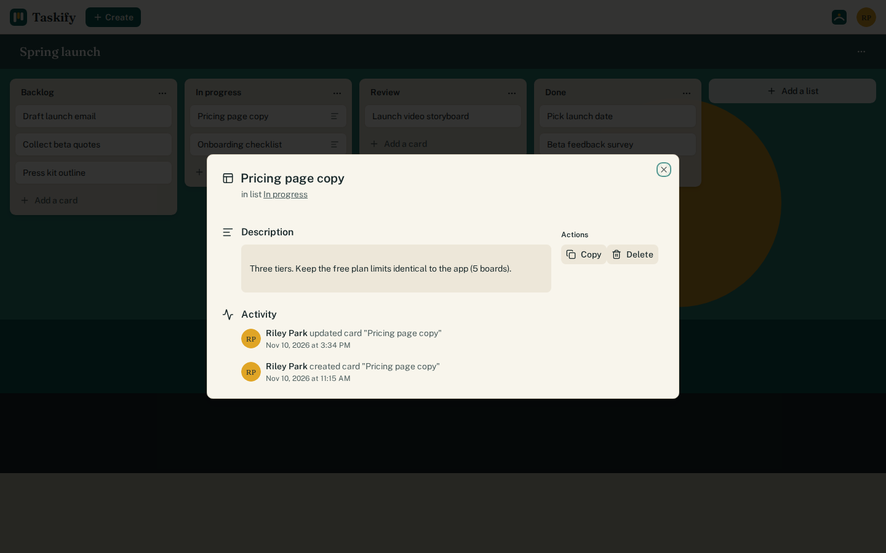
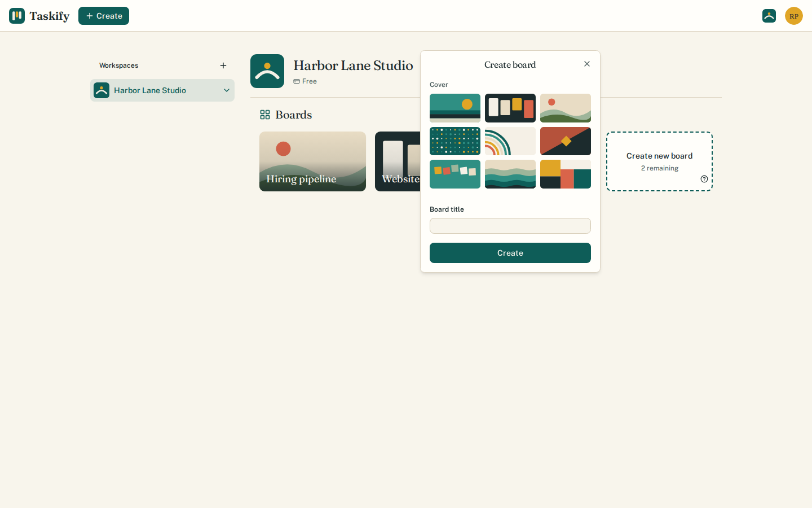
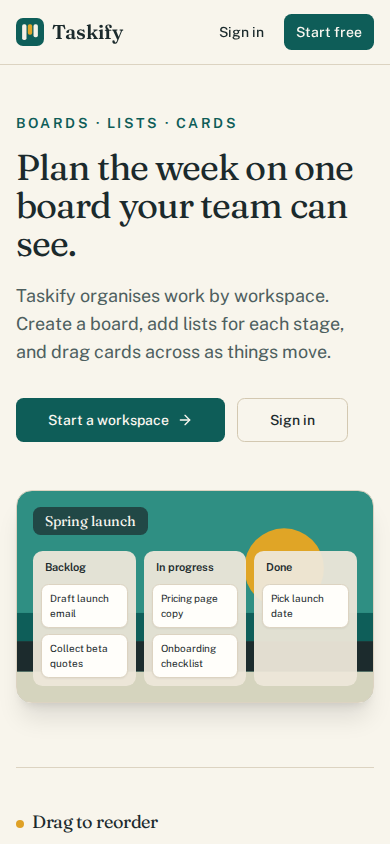
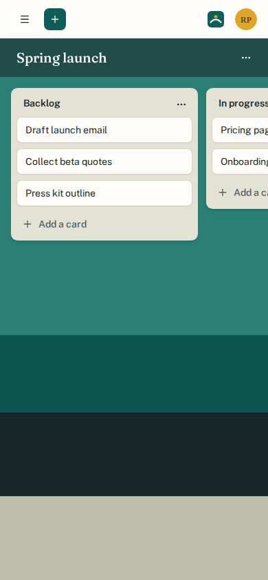
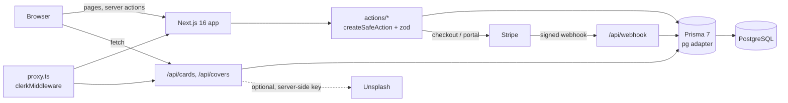

# Taskify

A Trello-style board app for small teams. Each workspace (a Clerk
organisation) gets boards; a board holds lists, and lists hold cards you drag
between them. Every create, rename and delete is recorded in an audit log, and
a Stripe subscription lifts the free plan's five-board limit.



## Where this comes from

This is a tutorial follow-along. The app, its name ("Taskify") and its
structure (`createSafeAction`, `useAction`, the card and upgrade modals, the
org board limit) follow **Code With Antonio's "Trello clone" course** (Next.js
14, server actions, Clerk, Prisma, Stripe). The tutorial used MySQL; this copy
uses PostgreSQL.

A later pass upgraded and hardened it:

- Next 14 to 16 with React 19, Clerk 4 to 6, Prisma 5 to 7, zod 3 to 4, Stripe 16 to 23
- fixed a cross-organisation card move, a race in the free-board limit, the
  webhook's handling of missing secrets, and a drag-and-drop ordering bug
- input validation, an audit-log naming fix, accessibility work and a new
  visual identity
- a Vitest suite that runs server actions against a real Postgres database
- Docker, Compose, seed data and a Clerk-free demo build

## Features

- **Workspaces, boards, lists, cards.** Boards belong to the active Clerk
  organisation. Lists and cards can be created, renamed, copied and deleted.
- **Drag and drop** for lists and cards (`@hello-pangea/dnd`), within and
  across lists. The server checks every id against the board and org, then
  renumbers each list it touched.
- **Card details**: a modal with an editable title and description and the
  card's last three activity entries.
- **Activity log** per workspace.
- **Free plan limit**: five boards per workspace, enforced atomically.
- **Pro plan** through Stripe Checkout and the billing portal; a webhook
  records the subscription period.
- **Board covers**: nine bundled SVG covers, or random photos from an Unsplash
  collection when `UNSPLASH_ACCESS_KEY` is set (fetched on the server; the
  photographer is credited on the board).

| Boards | Board |
| --- | --- |
|  |  |
| **Card details** | **New board** |
|  |  |

<p>
  
  
</p>

## Quick start (Docker, no accounts needed)

```bash
docker compose up --build
```

Then open <http://localhost:3000>, choose **Sign in**, then **Enter the demo
workspace**.

This starts Postgres, applies the migrations, seeds a fictional workspace
("Harbor Lane Studio") and serves a **demo build**. In a demo build
(`TASKIFY_DEMO_AUTH=1`) `@clerk/nextjs` is swapped at build time for the
small stand-ins in `demo/`. A cookie set on the sign-in page decides whether
you are signed in, and everyone shares one user. Nothing contacts Clerk. Use
demo mode only on your own machine and never deploy it.

Stop with `docker compose down` (add `-v` to drop the database).

## Running with real Clerk and Stripe

1. `cp .env.example .env`
2. In the [Clerk dashboard](https://dashboard.clerk.com), create an
   application, **enable Organizations**, and copy the publishable and secret
   keys into `.env`. Set `TASKIFY_DEMO_AUTH=0`.
3. Optional: add `STRIPE_API_KEY` and `STRIPE_WEBHOOK_SECRET`, then point a
   Stripe webhook (or `stripe listen --forward-to localhost:3000/api/webhook`)
   at `/api/webhook` for `checkout.session.completed` and
   `invoice.payment_succeeded`.
4. Optional: add `UNSPLASH_ACCESS_KEY` for photo covers.
5. `docker compose up --build`

Compose reads `.env` for the build arguments and runtime settings. The
`NEXT_PUBLIC_*` values are baked in at build time, so rebuild after changing
them.

### Without Docker for the app

Requires Node 22 (`.nvmrc`) and any PostgreSQL 14+ database.

```bash
npm ci                    # also runs prisma generate
npx prisma migrate deploy # uses DATABASE_URL from .env
npm run db:seed           # optional, demo workspace
npm run dev
```

## Tests

```bash
docker compose --profile test run --rm test
```

This resets a separate `taskify_test` database and runs the Vitest suite
(59 tests in 13 files) inside the image. With Node installed and
`DATABASE_URL` pointing at a disposable database, `npm test` does the same.

- **Server actions** (`tests/actions`) run against real Postgres with Clerk's
  `auth()`/`currentUser()` and `next/cache` mocked. The tests cover org
  scoping (a card cannot be moved into another org's list), list and card
  reordering, and eight concurrent `createBoard` calls of which exactly five
  succeed. They also cover Pro orgs and deleting boards.
- **Route handlers** (`tests/api`): the Stripe webhook with payloads signed
  locally, a stubbed `subscriptions.retrieve`, and checks for missing,
  forged and misconfigured requests. Also the covers route (Unsplash `fetch`
  mocked) and the card route.
- **Unit and component tests**: schemas, reorder helpers, audit messages,
  and the cover picker and form errors with Testing Library.

No test calls Clerk, Stripe or Unsplash.

`npm run lint` (ESLint 9 flat config) and `npm run typecheck` are clean.

## API

Besides server actions, three route handlers serve the client.
These responses were captured from the demo build:

```http
GET /api/cards/c853945f-3055-5f6b-ab89-987774e10499
Cookie: taskify_demo_session=1

200 OK
{"id":"c853945f-3055-5f6b-ab89-987774e10499","title":"Pricing page copy","order":0,
 "description":"Three tiers. Keep the free plan limits identical to the app (5 boards).",
 "listId":"bdb35079-f841-59d4-8f2a-1ab6d0df4bb6","createdAt":"2026-11-10T16:48:41.587Z",
 "updatedAt":"2026-11-10T16:48:41.587Z","list":{"title":"In progress"}}
```

A card in another organisation, or an unknown id, returns `404 Not Found`.
Signed-out requests return `401 Unauthorized`. `GET /api/cards/:id/logs`
returns the card's three most recent audit entries.

```http
GET /api/covers
Cookie: taskify_demo_session=1

200 OK
[{"id":"harbour","thumbUrl":"/covers/harbour.svg","fullUrl":"/covers/harbour.svg",
  "linkHtml":"/covers/harbour.svg","userName":"Taskify","alt":"Teal bands under a marigold sun"}, ...]
```

```http
POST /api/webhook        (no Stripe-Signature header)

400 Bad Request
Missing Stripe-Signature header
```

## How it fits together



| Path | What lives there |
| --- | --- |
| `app/(marketing)` | Landing page |
| `app/(platform)` | Clerk pages and the dashboard: org boards, board view, activity, billing, settings |
| `actions/<name>/` | One server action per folder: `schema.ts` (zod), `types.ts`, `index.ts` |
| `lib/` | Prisma client, org limit, subscription check, reorder helpers, shared schemas, cover list |
| `demo/` | Clerk stand-ins used only by demo builds |
| `prisma/` | Schema, migrations, `seed.sql` |
| `tests/` | Vitest suites and mocks |

## Design notes

- **Every mutation is scoped to the active org.** Actions read `orgId` from
  Clerk and include it in the `where` clause (`board: { orgId }`). The
  reorder actions also check that every card, list and target list belongs
  to the board named in the request, inside one transaction.
- **The free-board limit is one SQL statement.** `claimBoardSlot` runs
  `INSERT .. ON CONFLICT DO UPDATE .. WHERE count < 5 RETURNING` in the same
  transaction as the board insert. Concurrent requests queue on the row lock
  and re-check the count. Boards created on Pro are counted too, so a lapsed
  plan shows the right number.
- **Reordering is normalised on the server.** After applying the client's
  positions, every touched list is renumbered `0..n-1`. A partial or stale
  request cannot leave gaps or duplicates.
- **The webhook fails closed.** A missing secret or API key returns 500, a
  missing or invalid signature returns 400, and nothing is read or written
  before verification. A repeat checkout upserts, and an out-of-order renewal
  is not an error.
- **Cover values are validated.** The picker submits
  `id|thumb|full|link|user`. The zod schema parses it and only accepts bundled
  `/covers/*.svg` files or Unsplash URLs, because the values end up in CSS
  `url()` and links.
- **Demo mode is a build-time alias** (`next.config.js`), not a runtime flag,
  so a normal build contains no demo code.

## Known limitations

- Settings and organisation management are Clerk's hosted components. Demo
  builds show a placeholder there, and the screenshots use demo mode.
- Billing has not been run against a real Stripe account in this pass. The
  webhook is covered by signed-payload tests, and checkout and the portal by
  type checks only.
- Tailwind stays on v3. Moving to v4 is a separate migration.
- Next 16.4 answers the first prefetch of each dynamic route with a 307 to a
  different `_rsc` key, and the client retries once. This is harmless, but
  links to the optional catch-all auth routes have prefetch disabled because
  they retried indefinitely.

## License

MIT, see [LICENSE](LICENSE).
